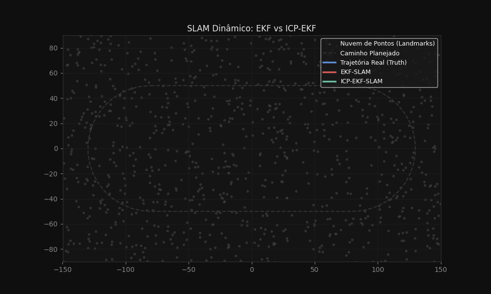
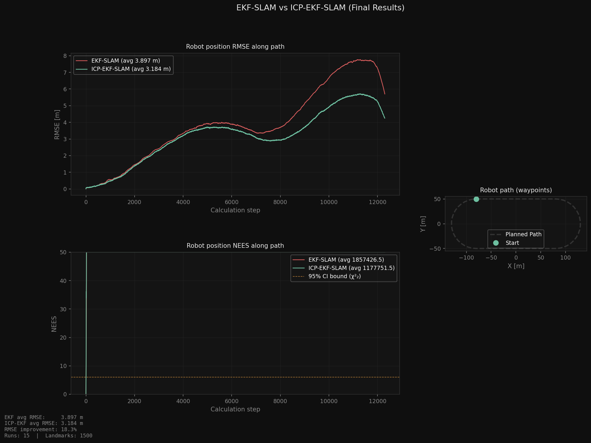

# EKF-SLAM vs ICP-EKF-SLAM

Replicação, em Python, da comparação entre **EKF-SLAM** clássico e **EKF-SLAM corrigido por ICP** proposta por Eraghi et al. (ICCIA 2023). Um robô com modelo de bicicleta percorre uma pista oval cercada por 1.500 landmarks; a cada passo, o ICP (via SVD) alinha as observações consecutivas e usa esse alinhamento para corrigir a pose antes da atualização do filtro de Kalman estendido.



## Resultados

Média de 15 execuções de Monte Carlo, 1.500 landmarks:

| Método | RMSE médio da posição |
|---|---|
| EKF-SLAM | 3,897 m |
| ICP-EKF-SLAM | **3,184 m** |
| **Melhoria** | **18,3 %** |

O ganho aparece principalmente na segunda metade da trajetória, quando o erro acumulado do EKF puro cresce mais rápido.



## Como funciona

1. **Ambiente:** mapa aleatório de landmarks e waypoints formando uma pista oval.
2. **Movimento:** modelo cinemático de bicicleta com ruído na velocidade e no esterçamento.
3. **Observação:** sensor de alcance e ângulo (range-bearing) com alcance máximo de 25 m.
4. **ICP:** as observações de dois instantes consecutivos são levadas ao referencial do robô e alinhadas por SVD; a rotação e a translação estimadas corrigem a pose prevista.
5. **EKF:** predição e atualização padrão com associação de dados conhecida.
6. **Avaliação:** RMSE e NEES da posição do robô ao longo do caminho, em várias execuções.

## Como executar

```bash
pip install -r requirements.txt
python ekf.py
```

O script roda o Monte Carlo, imprime o resumo no terminal e gera `slam_comparison.png` e `slam_animado.gif`. Parâmetros como número de landmarks, execuções e ruídos ficam no topo de `ekf.py`.

## Tecnologias

Python · NumPy · Matplotlib

## Referência

Eraghi et al., *ICP-EKF-SLAM*, ICCIA 2023.

---

Feito por [João Pedro Pimenta](https://www.linkedin.com/in/joao-pedro-pimenta/).
